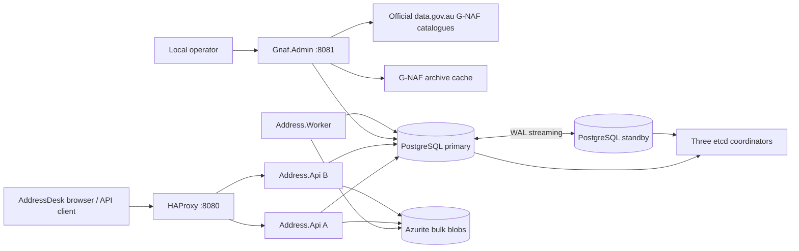
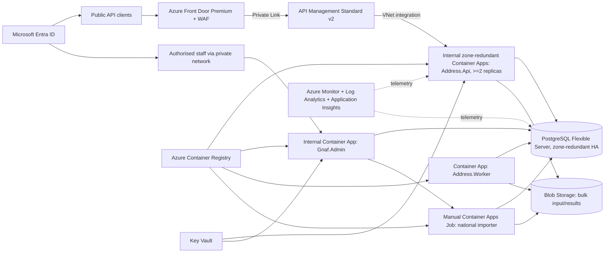
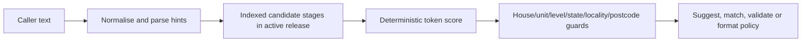
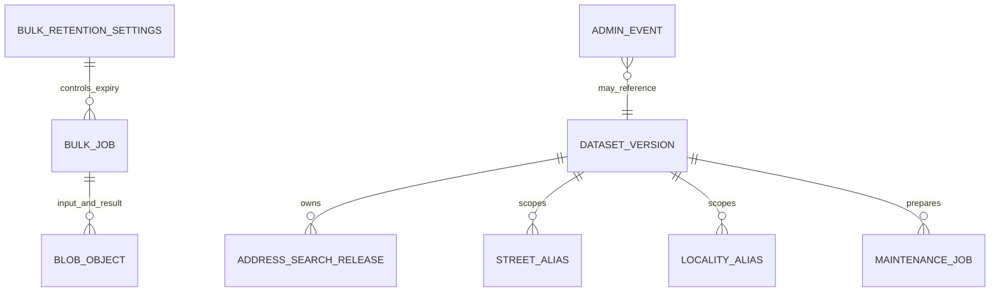

# AddressDesk: system design and operating specification

**Status:** local implementation and proposed Azure end state  
**Prepared:** 8 October 2026  
**Scope:** complete national G-NAF address matching, bulk migration, release administration, and operations

This is the single reference document for the current product and its intended Azure design. **Implemented** means present in this repository and exercised locally. **Proposed** means a design decision to validate before spending on Azure; it is not an assertion that the cloud service has been deployed or tested. Matching establishes similarity to the installed G-NAF release. It does not prove occupancy, identity, property ownership, or postal deliverability.

At the time this document was prepared, `/health/ready` reported `2026_02` as the active full national release and `platform.dataset_version` also contained `2026_08` as `READY`. Those are a dated operational snapshot, not architectural constants. Older project notes describe earlier release states; query the API or portal for the current one.

## 1. Architectural design

### 1.1 Current local architecture — implemented



| Component | Responsibility | Important boundary |
| --- | --- | --- |
| `Address.Core` | Normalisation, parsing, scoring, component guards, validation policy | No HTTP or database dependency. |
| `Address.Data` | PostgreSQL search, schema migration, release lifecycle, importer, job records, Blob adapter | Queries the stable `api.address_search` view. |
| `Address.Api` | Public UI, OpenAPI, synchronous API, bulk submission/status/download | Two local instances; each admits at most 16 concurrent address requests by default. |
| HAProxy | Health-checking entry at port 8080 | Routes to ready API instances; is still one local gateway. |
| `Address.Worker` | Claims durable bulk jobs, processes NDJSON, expires jobs and blobs | Uses the same matching service as synchronous requests. |
| `Gnaf.Admin` | Official release preparation, quality review, promotion, rollback, deletion, cluster and storage status | Local development port 8081; browser mutations require antiforgery tokens. |
| `Gnaf.Loader` | Explicit technical CLI for release and test operations | Not part of the public API. |
| PostgreSQL A/B, Patroni, etcd | Active database, streaming standby, automated local failover | Both copies and all coordinators share one computer; a host failure still takes down the service. |
| Azurite and cache volume | Bulk payloads/results and temporary official ZIPs | Cache is pruned after release use; bulk objects expire under the operator setting. |

The API process remains running while an official release is imported into a separate schema. Activation changes a PostgreSQL view and release metadata within one transaction. Readers see the old or new committed release. A full national import can still compete for local I/O: the [N−3 rehearsal](N3-REHEARSAL.md) recorded a host-level stall during May import and one timeout during August preparation. This is an availability risk to fix and retest, not a guarantee of uninterrupted imports.

### 1.2 Azure end state — proposed, not provisioned



The proposed single-region production bill of materials is below. It is intentionally explicit because API and database redundancy alone do not cover ingress, identity, secrets, storage, or recovery.

| Azure resource or configuration | Required role in end state | Implementation work before deployment |
| --- | --- | --- |
| Resource group, VNet, sized subnets, NSGs, private DNS zones/endpoints | Separate public edge from private app, PostgreSQL, Storage, Key Vault, and Registry access | Select region and CIDRs; prove all private DNS paths in a test environment. |
| Azure Front Door **Premium** with WAF and custom HTTPS domain | Public edge, WAF, health-based routing, private origin connection to APIM | Define WAF rules, TLS, origin health and cost envelope. [Microsoft documents Front Door Premium Private Link to APIM.](https://learn.microsoft.com/en-us/azure/frontdoor/standard-premium/how-to-enable-private-link-apim) |
| API Management **Standard v2** with inbound private endpoint and outbound VNet integration | JWT validation, client policies, request limits, API version exposure; private route to internal API | Validate this tier's networking, region and capacity in a pilot. [The supported inbound/outbound configuration is documented by Microsoft.](https://learn.microsoft.com/en-us/azure/api-management/private-endpoint) |
| Zone-redundant, VNet-integrated Azure Container Apps environment | Run API, worker and admin containers across zones | Set API minimum replicas to at least two and test zone loss; choose workload profile after load tests. [Container Apps zone guidance](https://learn.microsoft.com/en-us/azure/container-apps/disaster-recovery). |
| Container Apps: API, worker, admin; manual importer job | Replace local HAProxy/containers and run finite national imports independently | Keep API internal; set readiness probes and bounded scale. Adapt archive cache from local filesystem to durable Blob staging. [Container Apps jobs](https://learn.microsoft.com/en-us/azure/container-apps/jobs). |
| Azure Database for PostgreSQL Flexible Server, zone-redundant HA, private access | One managed primary with standby in another zone and stable database endpoint | Size storage for **active + previous + candidate raw/indexes + WAL + headroom**. Enable and verify `pg_trgm` in Azure's extension allowlist. Do not carry Patroni/etcd into Azure. [HA](https://learn.microsoft.com/en-us/azure/postgresql/high-availability/concepts-high-availability), [extension setup](https://learn.microsoft.com/en-us/azure/postgresql/extensions/how-to-create-extensions). |
| Blob Storage with private endpoint and suitable redundancy | Durable bulk input/results and staged source archives | Replace local Azurite connection-string assumptions with managed identity; separate bulk and source prefixes/containers. Keep application-level 24-hour bulk deletion and add a lifecycle safety net. [Blob lifecycle rules](https://learn.microsoft.com/en-us/azure/storage/blobs/lifecycle-management-policy-delete). |
| Azure Container Registry | Versioned, immutable API/worker/admin/importer images | Pull using managed identity; promote one tested image digest through environments. [Managed identity pulls](https://learn.microsoft.com/en-us/azure/container-apps/managed-identity-image-pull). |
| Microsoft Entra ID, app registrations, managed identities, Key Vault | Human/client authentication, service identity and secret/certificate storage | Register one API resource and one admin web client; caller applications receive their own identities. **No registration per API replica is needed.** Validate roles `Address.Read` and `Address.Admin`; use managed identities for Azure resources. Existing PostgreSQL/password and Blob connection-string code needs adaptation or securely stored transitional secrets. |
| Azure Monitor, Log Analytics, Application Insights, action groups | Cross-service traces, dashboards, alerts and paging | Instrument .NET apps, include correlation IDs, alert on 5xx/429, latency, replica loss, DB storage, failover, import failures and backup/restore checks. [Container Apps observability](https://learn.microsoft.com/en-us/azure/container-apps/observability). |
| Flexible Server automatic backup/PITR and a tested recovery procedure | Recover from accidental deletion/corruption, which HA replicates | Set retention/RPO/RTO with the owner; rehearse point-in-time restore and decide whether geo-redundant backup is needed. [Backup and restore](https://learn.microsoft.com/en-us/azure/postgresql/backup-restore/concepts-business-continuity). |
| Staff private access, such as an approved corporate VPN/ExpressRoute path | Reach the internal admin portal without publishing it on the public API edge | Choose and test the organisation's network access method; enforce Entra admin role and MFA policy. |

**Connectivity and identities.** Public traffic reaches only Front Door, then APIM over Private Link, then the internal API through VNet integration. The admin portal has a separate private staff path. APIM can validate Entra tokens, while the API must continue validating issuer, audience and role itself. [APIM Entra token policy](https://learn.microsoft.com/en-us/azure/api-management/validate-azure-ad-token-policy). API replicas share an API registration; a separate admin client registration handles OIDC redirect/cookie flows. Managed identities are assigned to workloads for Registry, Blob, Key Vault and, after implementation and testing, PostgreSQL. Production mode already rejects missing API bearer configuration and missing admin OIDC/key settings, but actual Entra sign-in, shared key storage and private networking have **not** been exercised end to end.

**Failover semantics.** Flexible Server HA replaces the local Patroni/etcd pair; PostgreSQL does not host the .NET API. Zone redundancy and two or more API replicas protect against a single zone or replica fault, subject to health-probe and platform detection time. A database takeover can interrupt in-flight calls; clients must retry eligible reads and idempotent match/validate/format requests with backoff. Managed HA is not a backup. Microsoft describes standby failover and separate point-in-time restore capabilities in its [PostgreSQL HA guide](https://learn.microsoft.com/en-us/azure/postgresql/high-availability/concepts-high-availability).

**Cost and deployment gate.** This is the end state, not an instruction to provision it now. Front Door Premium, APIM, zone-redundant PostgreSQL and always-on API replicas have real standing costs. Choose region, SKUs, scale bounds and budget after the local product and independent matching-quality evaluation are accepted. Azure infrastructure-as-code, identity integration, restore tests and Azure load tests are still required.

## 2. How matching works



### 2.1 Normalisation and parsing

`AddressNormalizer` uppercases, removes accents, changes punctuation into spaces, collapses repeated spaces and expands common street/subaddress abbreviations. A short street-type variant is also made for database lookup. `SubaddressParser` recognises common representations of units, flats, apartments, suites, shops, floors, levels, ground and basement variants. The search extracts any available house number, street, postcode, state and locality hints. These are comparison/search values; the API returns canonical G-NAF values after a match. An input such as `4/100 George Rd` is compared in a unit-aware form rather than treating `4` as the street number.

### 2.2 Candidate retrieval: selective stages, then trigrams

The repository reads `api.address_search`, which points at the currently active `gnaf_YYYY_MM.address_search`. It stops at the **first nonempty stage** below. Thus results are ranked inside a bounded candidate set; the algorithm does not exhaustively compare all national rows.

| Order | Stage | Index and rule |
| ---: | --- | --- |
| 1 | Exact normalised/abbreviated `search_text` | Equality on the serving text. |
| 2 | `search_text` prefix | B-tree `text_pattern_ops`; shorter completions first. |
| 3 | Official locality/street aliases | Expand only an unambiguous release-specific mapping; retry exact/prefix lookup against the canonical text. |
| 4 | Street prefix plus number/postcode/unit hints | B-tree street prefix, house number and postcode indexes; unit first pass if supplied. |
| 5 | Fuzzy street | PostgreSQL `pg_trgm` `%` operator on `street_name`, narrowed by house number/postcode; order by `similarity(search_text, input)`. |
| 6 | Postcode fallback | Bounded candidates in the given postcode, optionally constrained by house number. |

A **trigram** is a three-character fragment of text. PostgreSQL compares overlap in those fragments so a spelling variation can find a similar street. The `street_name gin_trgm_ops` GIN index supports the fuzzy `%` filter; a separate `search_text` trigram index supports text search. `similarity()` is used for SQL ordering. PostgreSQL's trigram threshold and SQL rank are **candidate retrieval tools**, not the public confidence score or validation decision. [PostgreSQL `pg_trgm` reference](https://www.postgresql.org/docs/17/pgtrgm.html). The repository requests roughly four times the caller's requested count, clamped to 20–100 rows, before scoring in C#.

Aliases come from official G-NAF street/locality alias PSV files, kept in compact maps keyed by release. An ambiguous locality alias or street alias with multiple canonical targets is not expanded as a definite mapping. Alias matching still has to pass the same number and subaddress guards. G-NAF address-alias rows are counted during import but are not a separate runtime search path.

### 2.3 Scoring and acceptance

If comparison text is equal after notation equivalences, the score is `1.0`. Otherwise, for each input token, the scorer counts a candidate token that is identical or begins with that input token when the input token has at least three characters:

```text
score = round(matched input tokens / max(input token count, candidate token count), 3)
```

Unit/flat/apartment and common level words are made equivalent **for comparison**. If a candidate contains a building name, the scorer also tries a comparison without it and keeps the better score. An explicitly conflicting house number, postcode, state, locality, unit number/type, or level type/number caps the score at `0.79`. A candidate specifying a unit/level that the caller omitted is capped too. Residential `UNIT`, `FLAT` and `APARTMENT` can be compatible; a `SUITE` is distinct. Ground and lower-ground remain distinct. These guards prevent a high text overlap from confirming the wrong apartment or neighbouring address.

The present **acceptance floor is 0.8**. It is a deterministic similarity policy, **not a calibrated probability** and not postal verification. `Suggest` has no 0.8 acceptance floor: it returns ranked choices for review. Bulk suggestion `minScore` only filters candidates; it does not turn one into a validated address. `Match` may expose a `PARTIAL` candidate below 0.8, but suppresses the address object when it classifies `SUBADDRESS_UNCONFIRMED`. `Validate` returns `valid: true` and canonical G-NAF data only at or above 0.8. `Format` returns canonical text only at or above 0.8; otherwise it returns normalised input with `matched: false`.

| Match type | Meaning |
| --- | --- |
| `EXACT` | Caller text equals the canonical line, ignoring case/outer spaces. |
| `NORMALISED` | Equivalent comparison notation yields a match. |
| `ALIAS` | A confident result used an official, unambiguous street/locality alias. |
| `FUZZY` | Another candidate scored at least 0.8. |
| `PARTIAL` | A candidate exists below the acceptance floor. |
| `SUBADDRESS_UNCONFIRMED` | Building/street is plausible but supplied unit or floor is unconfirmed. |
| `NO_MATCH` | No usable candidate or input too short. |

**Quality limit:** the existing national golden set is drawn from G-NAF itself. It detects regressions but does not establish real-world false-positive/false-negative rates. Independently labelled ambiguous user inputs are required before a production claim about the 0.8 threshold.

## 3. API endpoints and response contract

### 3.1 Address API, port 8080 locally

| Method/path | Request | Result and main rule |
| --- | --- | --- |
| `GET /health/live` | None | Process liveness, independent of database. |
| `GET /health/ready` | None | 200 only with reachable PostgreSQL and an active full national G-NAF release; otherwise 503. |
| `GET /v1/metadata` | None | Active release, capabilities, limits, retention and health URLs. |
| `GET /v1/addresses/{gnafPid}` | PID (1–80 chars) | Exact ID, canonical line, components, coordinates and dataset provenance; 404 if absent. |
| `GET /v1/addresses/suggest?q=...&limit=10` | `q` 1–200 chars; limit 1–20 | Ranked canonical choices with ID, score and components; no validation assertion. |
| `POST /v1/addresses/match` | `{"address":"..."}` (1–500 chars) | Best candidate, confidence and match type; possibly partial/unconfirmed. |
| `POST /v1/addresses/validate` | Same body | `valid`, validation status/level/confidence, G-NAF ID and components only on acceptance. |
| `POST /v1/addresses/format` | Same body | Canonical matched text, or normalised unmatched input. |
| `POST /v1/bulk?operation=...` | UTF-8 `application/x-ndjson`, at most 100 MB | 202 with job ID, secret access token and status URL. Operations: `ID`, `SUGGEST`, `MATCH`, `VALIDATE`, `FORMAT`. |
| `GET /v1/bulk/{jobId}` | Job token plus identity outside Development | Status, progress, result URL and expiry; 404 without access. |
| `GET /v1/bulk/{jobId}/result` | Same access | Completed NDJSON stream; 409 while unfinished. |
| `GET /admin/gnaf/status` | Admin role | Installed release summary; not a public data endpoint. |
| `/swagger` | Browser | OpenAPI UI with navigation back to AddressDesk. |

SUGGEST bulk jobs accept `minScore` from 0–1 (default 0) and `limit` 1–20 (default 5). Each input line is `{"address":"...","reference":"optional-source-key"}` for text operations or `{"id":"GNAF_PID"}` for ID. The output has one NDJSON row per input row, including `INVALID_INPUT` rows. A source `reference` lets a migration pipeline rejoin suggestions to its records. The worker uses the same core match policy as synchronous requests. Running bulk jobs must finish before a release switch; queued jobs may start against the release active when they run.

Response components use `buildingName`, `flatType`, `flatNumber`, `levelType`, `levelNumber`, `numberFirst`, `numberLast`, `streetName`, `streetType`, `streetSuffix`, `locality`, `state`, and `postcode`; absent fields are `null`. `numberLast` is extracted from a canonical address range because the serving table does not persist it. `streetSuffix` is currently always `null` because the serving table does not retain it. Matched responses carry G-NAF PID, release context, and coordinates when present. They explicitly report `POSTAL_DELIVERY_NOT_VERIFIED`.

```json
{
  "valid": true,
  "validation": { "status": "GNAF_MATCHED", "level": "ADDRESS", "confidence": 1.0 },
  "gnaf": { "id": "<release-specific G-NAF PID>" },
  "address": {
    "formatted": "UNIT 3 100 GEORGE ST SYDNEY NSW 2000",
    "components": {
      "buildingName": null, "flatType": "UNIT", "flatNumber": "3",
      "levelType": null, "levelNumber": null, "numberFirst": "100",
      "numberLast": null, "streetName": "GEORGE", "streetType": "ST",
      "streetSuffix": null, "locality": "SYDNEY", "state": "NSW", "postcode": "2000"
    },
    "location": { "latitude": null, "longitude": null }
  },
  "postalDelivery": { "status": "POSTAL_DELIVERY_NOT_VERIFIED" },
  "datasetVersion": "<active version>",
  "correlationId": "<request id>"
}
```

The JSON above is **illustrative contract shape**, not a claim that that exact unit exists in the currently active release. Non-success errors use `{ "error": { "code", "message", "correlationId" } }`. Address overload returns 429 `API_BUSY` and `Retry-After: 1`; temporary PostgreSQL failure returns 503 `DATASTORE_UNAVAILABLE` and `Retry-After: 2`. Bulk submission is not idempotent if the caller loses its 202 response. Bulk result access requires the per-job token; outside Development it also requires the same submitting identity. The default retention is 24 hours, configurable by the operator from 1–168 hours; cleanup checks run every minute.

### 3.2 Admin portal/API, port 8081 locally

| Method/path | Purpose |
| --- | --- |
| `GET /` | Release workflow, installed releases, failover/API/storage status, retention, operator history. |
| `GET /health/live`, `GET /health/ready` | Process and database readiness; anonymous health probes. |
| `GET /api/system` | Direct database/API replica and coordinator assessment. |
| `GET /api/releases`, `GET /api/latest` | Official catalogue and latest-release discovery; read-only. |
| `GET /api/maintenance`, `GET /api/housekeeping`, `GET /api/events` | Import job, hourly local storage sweep and recent operator actions. |
| `POST /prepare` | Queue exact official release preparation. |
| `POST /promote/{version}`, `POST /rollback` | Activate a READY release or restore the retained previous release. |
| `POST /releases/{version}/delete` | Delete a retired national release after exact-version confirmation. |
| `POST /settings/bulk-retention` | Update the shared job-retention setting. |

All browser mutations require antiforgery tokens. Outside Development, the portal requires OIDC sign-in and `Address.Admin`; the public API requires bearer tokens with the appropriate `Address.Read` or `Address.Admin` role. Local Compose binds the unauthenticated Development portal to loopback only. The operator audit records actions and outcomes, but it is not a backup.

## 4. National release process

```mermaid
sequenceDiagram
    participant O as Operator
    participant A as Admin/Importer
    participant P as PostgreSQL
    participant C as Official catalogue
    participant API as Running API
    O->>A: Choose exact official release; Prepare
    A->>C: Resolve version and download ZIP
    A->>A: Verify filename/PSV headers; calculate archive hash
    A->>P: Create versioned schema; COPY raw PSV
    A->>P: Build serving table, alias maps and indexes; ANALYZE
    A->>P: Count, coverage and release-quality checks
    P-->>A: READY or FAILED
    API->>P: Continue reading existing api.address_search
    O->>A: Review READY report; Activate
    A->>P: Transaction: repoint view + update release states
    P-->>API: New active release on subsequent reads
    A->>P: Prune completed raw and superseded retired data
```

1. **Discover and select.** The portal lists exact current and archived official national GDA2020 releases; selecting one does not change the live API. National controls exclude synthetic/partial datasets.
2. **Download and preflight.** The background job records source URL, filename, ETag/last-modified where available, calculated SHA-256 checksum and size. The hash identifies the downloaded bytes for retries; it is not claimed to be a signature supplied by the publisher. The importer checks filename version, required PSV files/columns, cross-state header consistency and, when the active release has a stored manifest, header drift against that manifest **before ingestion**. Drift fails for importer review.
3. **Import separately.** PostgreSQL `COPY` streams selected PSV into `gnaf_<version>.raw_*`; the importer joins address detail, default geocode, street, locality, state and street-type information into `address_search`. It builds B-tree prefix/number/postcode and GIN trigram indexes, analyzes the serving table, and materialises compact official street/locality alias maps.
4. **Validate.** READY requires nonzero required data; serving address count equals raw supported addresses (`confidence <> '-1'`); all eight states/territories for a national release; nonzero postcodes; and geocode coverage at least **90%** by default. For a forward upgrade, address, street, locality, geocode, state, postcode and alias counts cannot fall by more than **10%** relative to the active quality report by default. A deliberately older historical replay skips only this forward relative-drop rule; source/count/coverage checks remain. Its report records `HistoricalReplay=true`.
5. **Review and activate.** An operator explicitly promotes a READY candidate. The release advisory lock and transaction change the stable view and ACTIVE/RETIRED metadata together. Promotion waits when a bulk job is running. No API process restart or dual-write is required. The old active release is kept as the single previous release for immediate rollback; older retired schemas, completed raw tables and obsolete archives are pruned.
6. **Recover or free storage.** Rollback atomically repoints the view to the latest retained previous release. The operator may later delete that retired schema, losing instant rollback but retaining the ability to reimport the official source. A failed candidate never changes the live view. An already imported failed historical candidate can be revalidated without a second full import when source checksum and schema identity match.

**Schema compatibility rule:** the view exposes a fixed, ordered column list. PostgreSQL `CREATE OR REPLACE VIEW` cannot remove/reorder existing columns. Additive serving changes need an explicit migration and compatibility test across old and new release schemas; do not casually replace the view with `SELECT *`. This rule arose from the earlier `42P16 cannot drop columns from view` failure.

**Space planning:** importing a new national candidate temporarily keeps live/previous serving data **plus** raw tables, a new serving table and indexes. The N−3 rehearsal reached about **22.03 GiB per database node before August activation**, versus **11.60 GiB per node afterward** with August and May retained, excluding WAL and filesystem overhead. Storage alerts must account for import peaks, two database copies and backup headroom. These are historical measurements, not a fixed release size.

## 5. Data model



The diagram shows logical associations. The migration does not enforce every association with a foreign key: job and audit history can outlive a release row after an old schema is pruned.

| Object | Key fields and purpose | Retention |
| --- | --- | --- |
| `platform.dataset_version` | `source_version`, `schema_name`, status/scope, source URL/filename/checksum/size, timestamps, `quality_report` JSONB, `source_schema` JSONB | Active, up to one retired national release, and any current candidate; superseded retired rows are removed on promotion. |
| `gnaf_<version>.raw_*` | Release-specific selected PSV data during build and validation | Dropped for completed active/retired releases after activation. |
| `gnaf_<version>.address_search` | One canonical serving row per supported G-NAF PID; formatted line, unit/level, first number, street, locality, state, postcode, coordinates and comparison text | Live and at most one previous national release; READY candidate temporarily adds another. |
| `api.address_search` | Stable read view over the active version's serving table | Repointed atomically on promote/rollback; no data copied by the switch. |
| `platform.street_alias`, `platform.locality_alias` | Compact official mappings keyed by `source_version`; ambiguous mappings are not promoted to exact search expansions | Kept with the corresponding installed release. |
| `platform.maintenance_job` | One queued/running national preparation, stage/status/error and timestamps | Job history remains for portal status; it is not source address data. |
| `platform.bulk_job` | Durable operation, progress, blob names, caller identity, hashed secret access token, suggestion options, heartbeat and completion time | Default 24 hours after completion; operator-configurable 1–168 hours. |
| `platform.bulk_retention_settings` | Singleton retention policy shared by API replicas and worker | Persistent configuration. |
| `platform.admin_event` | Bounded operator audit fields: action, outcome, actor, version, request ID and detail; never token/full request body | Persistent operational history, not a backup. |
| Blob objects | Bulk input and output NDJSON; in Azure, staged official ZIPs as a separate class | Bulk objects follow job retention; source ZIPs can be redownloaded and should be lifecycle-managed. |

The serving row is assembled principally from `ADDRESS_DETAIL` (PID, building/unit/level/street number and postcode), `LOCALITY` and `STATE` (place names), `STREET_LOCALITY` plus the street-type authority file (street name/type), and `ADDRESS_DEFAULT_GEOCODE` (latitude/longitude). These are joined on their G-NAF PIDs; `ADDRESS_DETAIL.confidence = '-1'` is excluded. The canonical `formatted_address` is constructed from those fields, while `search_text` is an uppercase punctuation-stripped comparison string. House and unit numbers remain text to preserve prefixes and suffixes. The source ZIP itself is not the long-term serving store.

The serving table has a primary key on `gnaf_pid` and indexes for normalised prefix, street prefix, postcode, first number, `street_name` trigram and `search_text` trigram. The public component projection returns missing values as `null`. Current omissions matter: `numberLast` is reconstructed from the formatted line, and `streetSuffix` is not persisted. A future schema change should store these explicitly and maintain old-release view compatibility.

## 6. Benchmarks, thresholds and evidence

### 6.1 Measured local performance — historical runs

| Test and date | Result | Interpretation |
| --- | --- | --- |
| Mixed baseline, 4 Oct 2026, 20 req/s for 45 s | 900 requests, **0 non-200**, p50 6.2 ms, p95 31.3 ms, p99 57.8 ms | Single-host reference, not production SLO. |
| API replica failure, tuned gateway | 1,200 requests, **0 non-200**; p95 131.2 ms, p99 1,065.9 ms | Other replica served requests; tail latency increased. |
| Database primary failover, after error mapping | 1,200 requests, **44 HTTP 503**, p95 68.3 ms | Automatic takeover has a visible failure window; callers need retries. |
| Release switch under 20 req/s traffic | 1,300 requests, **0 non-200**, p95 43.0 ms | Transactional view switch worked in that local rehearsal. |
| Highest zero-error sustained saturation run before admission control | **54,000 requests in 45 s**, target 72,000/min, 0 non-200, p95 21.4 ms | A 78,000/min 30 s run saw first 503s; the short 96,000/min success was not sustainable. |
| Heavy saturation at 96,000/min, 30 s repeat | 48,000 scheduled; **10,527 HTTP 503**, p95 1,325 ms | PostgreSQL client slots exhausted in that configuration. |
| Pool-budget repeat at 1,200 req/s | 36,000 requests in 30 s, **0 errors**, p95 23.3 ms | Capped pools removed the specific DB-slot rejection mode at this rate. |
| Admission control, 1,600 req/s for 20 s | 32,000 scheduled; 29,347 HTTP 200, 2,653 deliberate HTTP 429, 0 transport errors; p95 63.1 ms | Graceful overload rejection, **not** 1,600 successful req/s capacity. |
| Full August 2026 preparation, 6 Oct | 30 min 7 s; two 10-minute probe windows clean; third had one two-second timeout | Full national import did not establish uninterrupted service on one host. |
| Isolated 90 s database failure/restore rehearsal | 699 of 900 reads succeeded; 201 retryable 503; longest success gap 20.21 s | More severe than the short failover probe; use this for recovery risk discussion. |

Evidence: [traffic/failover](LOAD-REHEARSAL.md), [saturation and admission](SATURATION-REHEARSAL.md), [N−3 release replay](N3-REHEARSAL.md), and request traces in [`quality/results`](quality/results). These were local OrbStack tests, with workload and host contention; they do not size Azure or prove an annual availability percentage. The latest active release may differ from the release used in these runs.

### 6.2 Implemented policy thresholds

| Rule | Current value | Meaning |
| --- | ---: | --- |
| Validate/confirmed format score | `>= 0.8` | Heuristic dataset-match acceptance; not a probability. |
| Conflicting explicit components | cap at `0.79` | Prevent acceptance even with high text overlap. |
| National geocode coverage on import | `>= 90%` default | Candidate quality gate. |
| Forward relative count fall | `<= 10%` default | Applied across key counts/aliases; skipped only for deliberate older release. |
| National jurisdiction coverage | All 8 states/territories | Candidate quality gate. |
| Suggestions | 1–20, default 10 | Ranked choices, no acceptance floor. |
| Bulk SUGGEST options | score 0–1; limit 1–20, default 5 | Inclusive candidate filter and maximum per input. |
| Bulk upload | at most 100 MB | NDJSON request body. |
| Bulk retention | 24 h default; 1–168 h configurable | Blob and job cleanup checked each minute. |
| API address admission | 16 concurrent requests per replica, zero queue | Excess gets 429; tune after measurement. |
| Local storage alert | less than 10% or 5 GiB free | Hourly admin housekeeping warning; no external notification yet. |
| Coverage gates | Core 90% lines/60% branches; Data 80% lines/60% branches | CI floors, not whole-product coverage. |

**Proposed Azure acceptance gates, not yet measured:** preserve the national positive/negative regression corpus and bulk/synchronous parity; run an independently labelled match-quality study; then agree maximum false-positive rate and score threshold. Exercise a full national import while sustaining realistic external API traffic, measure p50/p95/p99 and 429/5xx separately, and rehearse API replica loss, zone failure, PostgreSQL failover and point-in-time restore. Set throughput SLO, RTO and RPO only from those measurements and the business requirement; do not transplant the local 72,000/min figure into an Azure commitment.

## 7. Operations, security and recovery

### 7.1 Current local controls

- PostgreSQL autovacuum is enabled; the importer runs `ANALYZE` after building a serving table. Routine `VACUUM FULL` is deliberately not scheduled because it takes an exclusive table lock and needs extra space. [PostgreSQL routine vacuuming](https://www.postgresql.org/docs/17/routine-vacuuming.html).
- The bulk worker sweeps expired jobs every minute. Admin housekeeping checks storage hourly and removes old unused source archives, skipping active preparation and files modified within 24 hours. The admin portal shows replica/coordinator, API and storage status.
- Local PostgreSQL uses a primary and streaming standby with Patroni/etcd; this protects one database container failure, not whole-computer failure. WAL is PostgreSQL's change log for crash recovery and streaming. PostgreSQL recycles unneeded segments; operators must not manually delete `pg_wal`. [PostgreSQL WAL](https://www.postgresql.org/docs/17/wal-intro.html).
- Readiness requires an active full national release. A database interruption returns a structured 503. API admission responds with a structured 429. Both responses include correlation identifiers and retry hints.
- Development auth is localhost-only. Outside Development, API bearer tokens, admin OIDC role, persistent Data Protection keys and CSRF checks are required by code. Actual cloud identity and HTTPS integration remain to be tested.
- The main local stack has **no persistent off-computer backup**. Rehearsal scripts perform disposable logical dump/restore tests; retained release rollback cannot recover accidentally deleted data once deletion replicates, or recover from loss of the host.

### 7.2 Azure operational design and runbooks to complete

| Operation | Target behavior and acceptance proof |
| --- | --- |
| CI/CD | Existing GitHub workflow checks .NET/Python/shell formatting, tests, coverage, images and synthetic service smoke. Add protected environments, OIDC to Azure, IaC plan/review, image-digest deployment, staged rollout, rollback and secret scanning. The repository now has local Git history but no remote; hosted CI has not run. |
| Authentication | Entra API resource registration with `Address.Read`/`Address.Admin`; separate admin OIDC client; workload managed identities; private admin access. Test role denial, token expiry, logout, key rotation and independent replicas. |
| Secrets and least privilege | Key Vault for remaining secrets; managed identity for Registry/Blob and later PostgreSQL; different database roles for API reads, worker writes and release administration. Do not put production secrets in Compose or the repository. |
| Monitoring | Alert on API 5xx and 429 trends, p95/p99 latency, unhealthy replicas, DB failover/lag, free storage and WAL growth, candidate validation failure, bulk backlog/cleanup failure and backup/restore test failure. Attach runbook and owner to each alert. |
| Database backup | Configure Flexible Server PITR retention, test restore to a separate server, verify active release/row counts/alias maps and an ID lookup. Agree regional-disaster strategy and restore-time target. HA synchronously copies mistakes too. |
| National release | Preflight, prepare, review and explicitly activate; hold previous serving release through acceptance; record checksums, counts, version and operator action; then delete previous only by deliberate decision. Rehearse historical replay and rollback. |
| Capacity | Budget PostgreSQL connections across maximum API replicas plus worker/admin/importer, leave management reserve, load-test private network path and full import peak. Implement queue/admission policies at both app and APIM layers. |
| Data retention/privacy | Keep bulk input/results at the configured short retention, restrict token/job access to the submitting identity, prevent address payloads and secrets from entering audit/telemetry, and define Blob soft-delete/lifecycle behavior consistent with the retention promise. |

### 7.3 Decisions needed before Azure provisioning

1. Region and availability-zone support, residency and G-NAF licence obligations.
2. Public client model and Entra tenant/app ownership; staff private network route.
3. Real address-match error tolerance from independently labelled data, and performance SLO at expected traffic.
4. Maximum acceptable failover interruption and restore RTO/RPO; backup retention and regional recovery need.
5. Storage/import headroom and cost budget for active, previous and in-flight candidate copies.
6. Implementation of Blob-backed source staging, managed identity, Azure IaC and deployment pipeline, then full Azure rehearsal.

**Implementation sources:** [matching code](src/Address.Core/AddressModels.cs), [database search and lifecycle](src/Address.Data/Database.cs), [official importer](src/Address.Data/GnafArchiveImporter.cs), [SQL schema](db/migrations/001_initial.sql), [API endpoints](src/Address.Api/Program.cs), [bulk worker](src/Address.Worker/Program.cs), [admin endpoints](src/Gnaf.Admin/Program.cs), and [local Compose topology](compose.yaml). This document should be revised alongside contract, release-policy or infrastructure changes.
