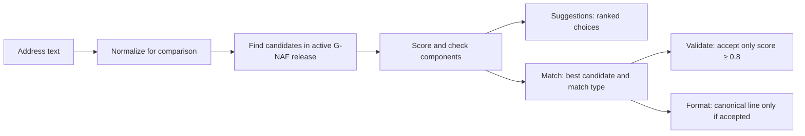

# How address matching works

This document describes the current local G-NAF API implementation. It covers suggestions, best-match lookup, validation, formatting, aliases, scores, and the cases the service deliberately does not confirm. The implementation lives in `src/Address.Core/AddressModels.cs`, `src/Address.Data/Database.cs`, and `src/Address.Api/Program.cs`.

## The short version



The service searches the **active release** through `api.address_search`. It returns the canonical G-NAF ID, address line, components, and coordinates where available. A release upgrade changes the database view; the API does not need a restart. The service does not check whether Australia Post will deliver to an address. Every relevant response says `POSTAL_DELIVERY_NOT_VERIFIED`.

## 1. Prepare the input

The comparison normalizer uppercases text, removes accents, replaces punctuation with spaces, and collapses repeated spaces. It also expands common street and subaddress abbreviations. For example:

| Input | Comparison text |
| --- | --- |
| `10 Collins St, Melbourne VIC 3000` | `10 COLLINS STREET MELBOURNE VIC 3000` |
| `4/100 George Rd` | `UNIT 4 100 GEORGE ROAD` |
| `Apt18C L1 54 Smith St` | `APARTMENT 18C L 1 54 SMITH STREET` |

The search layer also makes a short street-type version, such as `STREET` → `ST`, because G-NAF's canonical line may use a code. Normalization is for comparison; a successful match still returns the canonical G-NAF line. An unmatched format request returns normalized input **without claiming a G-NAF match**.

The parser extracts hints when the input contains them: house number, street name, postcode, state, locality, unit/flat/apartment or other subaddress, and level/floor. These hints narrow the database search and protect validation from accepting a nearby but different address. They are not all required for a suggestion.

## 2. Find candidates

The repository tries the following stages **in order** against the active serving view. It returns the first nonempty stage; it does not combine all stages into one globally ranked list.

| Stage | How it searches |
| --- | --- |
| Exact text | Normalized or abbreviated text equals indexed `search_text`. |
| Prefix text | `search_text` begins with the normalized or abbreviated query. Shorter completions are considered first. |
| G-NAF aliases | A release-specific street or locality alias is changed to its canonical name, then exact/prefix search is retried. |
| Street and number | Indexed street prefix, with the house number and final-token postcode when available; a supplied unit number gets a more selective first pass. |
| Fuzzy street | PostgreSQL trigram search for a similar street name, still narrowed by house number and postcode when available. |
| Postcode fallback | If a final-token postcode was supplied, rank addresses in that postcode, narrowed by house number when available. |

The SQL similarity ordering helps select candidates in the later stages. It is **not** the confidence score returned by the API. The repository normally fetches more candidates than the caller requested, up to 100, so the service can score and sort them. Because each stage stops at its first nonempty result and candidate sets are bounded, matching is a heuristic search, not an exhaustive proof that no better address exists.

### Official aliases

Each installed national release has compact maps from G-NAF street and locality alias files. A locality alias is used only when it maps to one canonical locality in that state. A street alias must identify one canonical street for its alias name and type in the relevant state and locality. Broad aliases such as `BELCONNEN`, which maps to many ACT localities, are not treated as an exact locality mapping.

For example, the August 2026 data maps `ABBOTT CL` in Palmerston to canonical `ABBOT CL`. The input `9 ABBOTT CL PALMERSTON ACT 2913` resolves to G-NAF ID `GAACT714904529`, and a confident match reports `matchType: "ALIAS"`. The returned label and components still say `9 ABBOT CL PALMERSTON ACT 2913`. The alias spelling is used only for comparison. G-NAF address-alias rows are counted during import but are not a separate search path today.

## 3. Score candidates and protect components

For each candidate, the service compares normalized tokens. Identical comparison text scores **1.0**. Otherwise, each input token counts as a match when the candidate has the same token or a candidate token beginning with it (for input tokens of at least three characters). The matched-input-token count is divided by the larger of the two token counts and rounded to three decimal places. Unit/flat/apartment wording and common level wording are treated as equivalent for this comparison. A building name may be removed from a candidate for a second comparison if that improves the score.

The result is a **similarity heuristic**, not a probability that the address is real or deliverable. The current acceptance threshold is **0.8**. Several mismatches cap the score at **0.79**, below that threshold:

| Input disagrees with candidate on… | Effect |
| --- | --- |
| Explicit house number, postcode, state, or locality | Candidate cannot validate. |
| Unit/flat/apartment number or incompatible subaddress type | Candidate cannot validate. Residential `UNIT`, `FLAT`, and `APARTMENT` types are compatible; a `SUITE` is distinct. |
| Level/floor type or number | Candidate cannot validate. `LOWER GROUND` and `GROUND` remain distinct. |
| Candidate has a unit or level that the input omits | Candidate cannot validate as that specific subaddress. |

For example, `Unit 99999 26 Military Rd North Bondi NSW 2026` finds the right building but does **not** validate as a particular unit. The current API reports `SUBADDRESS_UNCONFIRMED`, `valid: false`, and confidence `0.79`. A wrong house number on an alias street is also rejected. These checks depend on the hints the parser can extract, so unusual input layouts deserve separate testing.

## What each endpoint means

| Endpoint | Behaviour |
| --- | --- |
| `GET /v1/addresses/suggest?q=...&limit=10` | Returns ranked, canonical choices. The default limit is 10 and the maximum is 20. Duplicate formatted labels are collapsed. **There is no 0.8 cutoff for suggestions:** a low score is still a choice for a person to inspect, not a validation result. A query that normalizes to fewer than two characters returns an empty list. |
| `POST /v1/addresses/match` | Returns the highest-scoring candidate, its score, and a match type. A `PARTIAL` candidate may be returned below 0.8; callers must check the score/type before treating it as confirmed. For `SUBADDRESS_UNCONFIRMED`, the HTTP response deliberately sets `match` to `null`. |
| `POST /v1/addresses/validate` | Returns `valid: true` only when a candidate scores at least 0.8. A successful national match has status `GNAF_MATCHED`, level `ADDRESS`, G-NAF ID, and components. Otherwise `valid: false`, `gnaf: null`, and `address: null`; status is `SUBADDRESS_UNCONFIRMED` or `NO_MATCH`. |
| `POST /v1/addresses/format` | Returns the canonical G-NAF line and `matched: true` only at or above 0.8. Otherwise it returns comparison-normalized input with `matched: false`, no G-NAF ID, and no matched components. |
| `GET /v1/addresses/{gnafPid}` | Looks up that ID directly; it does not run text matching or calculate a confidence score. |

For an address-entry form, show suggestion `label` values as choices and retain the selected `id`. The selected ID can be fetched directly for its canonical components. If a user submits free text without choosing a suggestion, call `validate` for a yes/no dataset match or `match` when the application can handle a partial candidate. Do not silently accept the first suggestion merely because it is ranked first.

Match types describe **how the best candidate was classified**, not postal validity:

| Match type | Meaning |
| --- | --- |
| `EXACT` | Raw input, ignoring case and surrounding space, equals the canonical formatted line. |
| `NORMALISED` | The comparison text matches after abbreviation and equivalent subaddress wording are handled. |
| `ALIAS` | A confident result used an official street/locality alias. |
| `FUZZY` | Another candidate reached at least 0.8 after scoring. |
| `PARTIAL` | Best candidate exists but scores below 0.8. |
| `SUBADDRESS_UNCONFIRMED` | Building/street appears plausible, but the specified unit or level is not confirmed. |
| `NO_MATCH` | No usable candidate was found, or the normalized input was too short. |

The API accepts suggestion queries of 1–200 input characters and match/validate/format bodies of 1–500 characters. Empty input, excessive length, and invalid suggestion limits return HTTP 400. All address endpoints require the `Address.Read` role outside local Development mode.

## Response example

The live August 2026 service returns this canonical suggestion for an alias spelling (shown without the request-specific correlation ID):

```json
{
  "suggestions": [
    {
      "id": "GAACT714904529",
      "label": "9 ABBOT CL PALMERSTON ACT 2913",
      "score": 1,
      "components": {
        "buildingName": null,
        "flatType": null,
        "flatNumber": null,
        "levelType": null,
        "levelNumber": null,
        "numberFirst": "9",
        "numberLast": null,
        "streetName": "ABBOT",
        "streetType": "CL",
        "streetSuffix": null,
        "locality": "PALMERSTON",
        "state": "ACT",
        "postcode": "2913"
      }
    }
  ],
  "datasetVersion": "2026_08"
}
```

For that same input, the four text endpoints have different purposes:

| Operation | Observed outcome |
| --- | --- |
| Suggest | Offers `9 ABBOT CL PALMERSTON ACT 2913` with score `1`; the person can choose it. |
| Match | Returns G-NAF ID `GAACT714904529`, confidence `1`, and `matchType: "ALIAS"`. |
| Validate | Returns `valid: true`, `GNAF_MATCHED`, and the canonical components. |
| Format | Returns `matched: true` and the canonical line `9 ABBOT CL PALMERSTON ACT 2913`. |

The score is `1` because the official alias lets the comparison text match exactly. It does not mean the original spelling was the canonical street name or that postal delivery was checked.

Structured components describe the **matched canonical record**, not the spelling the caller typed. Absent values are `null`. The installed serving tables do not retain street suffix, so `streetSuffix` is currently `null`; `numberLast` is derived from a range in the canonical line. Coordinates may also be absent.

## Bulk and quality limits

Bulk `MATCH`, `VALIDATE`, and `FORMAT` rows use the same `AddressService` rules as synchronous calls. They return the release version, G-NAF ID, components, score, and status appropriate to that operation. A bulk job stays on one release while it runs.

The current [national regression corpus](QUALITY.md) has 18 positive and 11 negative cases, including units, levels, ranged street numbers, a real street alias, and wrong-unit/house/locality cases. These tests catch implementation regressions; they do **not** calibrate the 0.8 threshold against independently labelled real user input. Before relying on scores as a production decision policy, measure false positives and false negatives with such a set. Suggestions and `PARTIAL` matches should be presented as choices or leads, never as confirmed addresses.

See [API.md](API.md) for request and response fields and [DATABASE-SEEDING.md](DATABASE-SEEDING.md) for how the alias maps are populated from each release.
